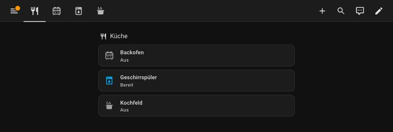
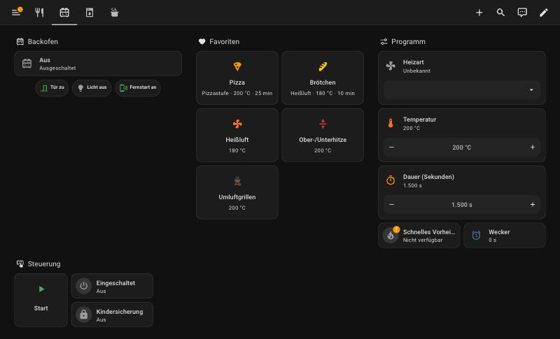
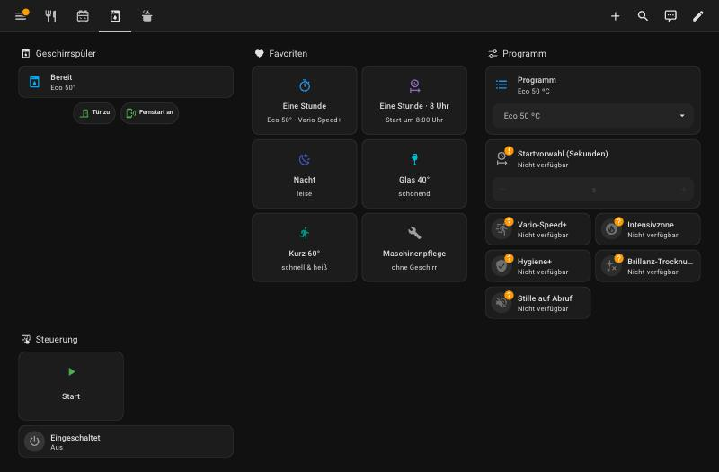
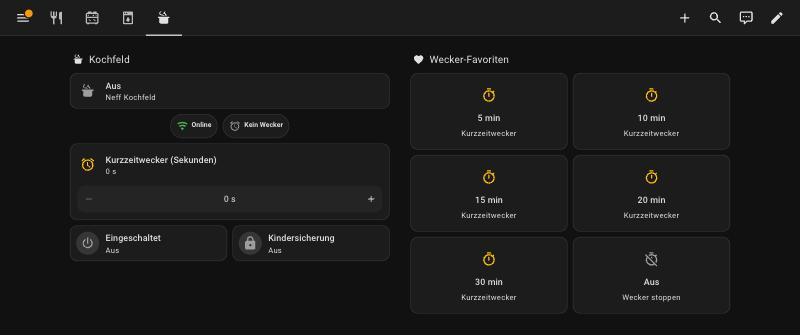

# 🍳 Neff Küche für Home Assistant

🇩🇪 Deutsch · [🇬🇧 English](README_EN.md)

Ein schönes, deutschsprachiges Home-Assistant-Dashboard für **Neff-Küchengeräte** (Backofen, Geschirrspüler, Kochfeld) über die offizielle **Home Connect**-Integration – mit Ein-Tipp-Favoriten wie „Pizza“, „Brötchen“ oder „Spüler in einer Stunde fertig“.

[](https://www.buymeacoffee.com/thoralf.brandt)


## Screenshots

| Übersicht | Backofen |
|---|---|
|  |  |

| Geschirrspüler | Kochfeld |
|---|---|
|  |  |

## Funktionen

**Übersicht** – alle drei Geräte auf einen Blick, Tippen öffnet die Detailseite.

**Backofen**
- Zustand und Heizart auf Deutsch, Garraumtemperatur als Zeiger, Fortschritt und „Fertig um …“
- Heizart, Temperatur und Dauer einstellen, Schnelles Vorheizen
- Start / Pause / Weiter / Stopp – es erscheinen nur die Buttons, die gerade passen
- **Favoriten:** Pizza (Pizzastufe 200 °C, 25 min), Brötchen (Heißluft 180 °C, 10 min), Heißluft 180 °C, Ober-/Unterhitze 200 °C, Umluftgrillen 200 °C

**Geschirrspüler**
- Programm auf Deutsch, Restzeit, Startvorwahl
- Extras zum Antippen: Vario-Speed+, Intensivzone, Hygiene+, Brillanz-Trocknung, Stille auf Abruf
- Hinweise nur bei Bedarf: Salz / Klarspüler nachfüllen, Tür offen, offline
- **Favoriten:** Eine Stunde (Eco 50° + Vario-Speed+), Eine Stunde mit Start um 8:00 Uhr, Nacht, Glas 40°, Kurz 60°, Maschinenpflege

**Kochfeld**
- Zustand, Ein/Aus, Kindersicherung
- Kurzzeitwecker-Buttons: 5 / 10 / 15 / 20 / 30 min und Aus

Alle Start-Buttons fragen vorher nach und sind ausgeblendet, solange schon ein Programm läuft.

## Voraussetzungen

- Home Assistant mit der Integration **[Home Connect](https://www.home-assistant.io/integrations/home_connect/)**
- **[Mushroom Cards](https://github.com/piitaya/lovelace-mushroom)** über HACS (in HACS als „Lovelace Mushroom“)
- Am Gerät **Fernstart** aktivieren, damit Programme aus HA gestartet werden können

## Installation

1. **Skripte:** Inhalt von [`scripts/neff_scripts.yaml`](scripts/neff_scripts.yaml) in deine `scripts.yaml` einfügen.
   `DEINE_BACKOFEN_DEVICE_ID` und `DEINE_GESCHIRRSPUELER_DEVICE_ID` ersetzen – die ID steht in der Adresszeile, wenn du unter *Einstellungen → Geräte* das Gerät öffnest. Danach Skripte neu laden.
2. **Dashboard:** *Einstellungen → Dashboards → Dashboard hinzufügen → Neu von Grund auf*, öffnen, dann *⋮ → Bearbeiten → ⋮ → Raw-Konfigurationseditor* und den Inhalt von [`dashboard/kueche-neff.yaml`](dashboard/kueche-neff.yaml) einfügen.
3. **Entity-IDs prüfen:** Die Namen hängen davon ab, wie deine Geräte heißen. Deine eigenen findest du unter *Entwicklerwerkzeuge → Template* mit:

   ```jinja
   
   {{ e }} | {{ states(e) }}
   
   ```

   Weichen sie ab, ersetze z. B. `backofen` / `geschirrspuler` / `kochfeld` per Suchen & Ersetzen.

## Gut zu wissen

- **Favoriten aus der Neff-App** werden von Home Connect nicht an Home Assistant weitergegeben. Deshalb sind sie hier als Skripte nachgebaut – eigene lassen sich nach dem gleichen Muster ergänzen.
- Neff lehnt Optionen ab, die ein Programm nicht unterstützt (z. B. *Schnellaufheizen* bei der Pizzastufe → `SDK.Error.UnsupportedOption`). Dann die Option im Skript weglassen.
- Die **Garraumtemperatur** wird nur gemeldet, solange der Ofen an ist. Im ausgeschalteten Zustand blendet das Dashboard den Wert deshalb aus.
- Dauer, Startvorwahl und Wecker rechnet Home Connect in **Sekunden**.

## Unterstützen

Wenn dir das Projekt gefällt, freue ich mich über einen Kaffee ☕

<a href="https://www.buymeacoffee.com/thoralf.brandt" target="_blank"></a>

Mehr Projekte: [lets-make.de](https://www.lets-make.de) · [github.com/TBR-BRD](https://github.com/TBR-BRD)

## Lizenz

[MIT](LICENSE) © Thoralf Brandt
