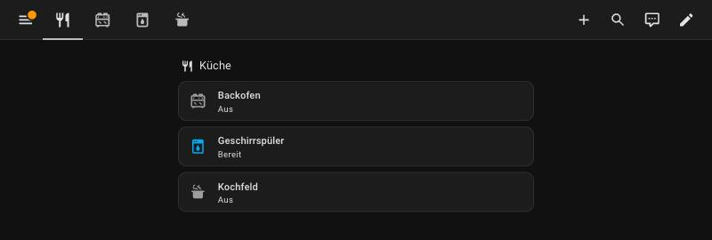
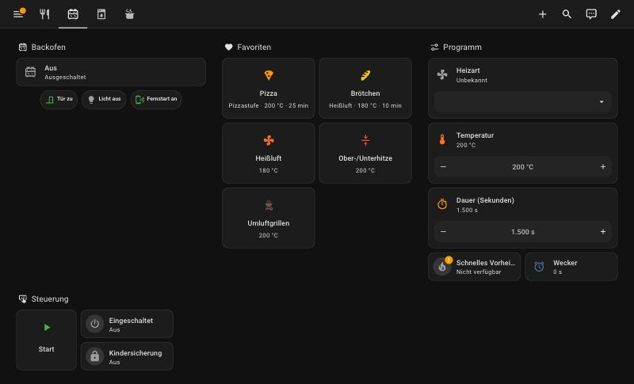
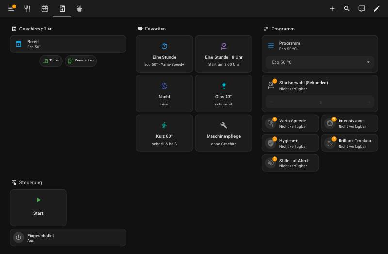
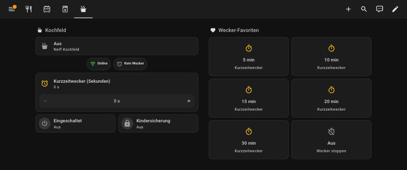

# 🍳 Neff Kitchen for Home Assistant

[🇩🇪 Deutsch](README.md) · 🇬🇧 English

A clean Home Assistant dashboard for **Neff kitchen appliances** (oven, dishwasher, hob) using the official **Home Connect** integration – with one-tap favorites like "Pizza", "Bread rolls" or "Dishwasher done in one hour".

> The dashboard labels are in German. All texts live in the YAML files and are easy to translate.

[](https://www.buymeacoffee.com/thoralf.brandt)


## Screenshots

| Overview | Oven |
|---|---|
|  |  |

| Dishwasher | Hob |
|---|---|
|  |  |

## Features

**Overview** – all three appliances at a glance; tap to open the detail page.

**Oven**
- Status and heating mode in plain words, cavity temperature as a gauge, progress and "done at …"
- Set heating mode, temperature and duration; fast preheat
- Start / Pause / Resume / Stop – only the buttons that make sense right now are shown
- **Favorites:** Pizza (pizza setting 200 °C, 25 min), Bread rolls (hot air 180 °C, 10 min), Hot air 180 °C, Top/bottom heat 200 °C, Hot-air grilling 200 °C

**Dishwasher**
- Program name, remaining time, delayed start
- Tap-to-toggle extras: VarioSpeed+, Intensive Zone, Hygiene+, Brilliance Dry, Silence on Demand
- Hints only when needed: refill salt / rinse aid, door open, offline
- **Favorites:** One hour (Eco 50° + VarioSpeed+), One hour starting at 8:00 am, Night, Glass 40°, Short 60°, Machine care

**Hob**
- Status, on/off, child lock
- Kitchen timer buttons: 5 / 10 / 15 / 20 / 30 min and off

Every start button asks for confirmation and is hidden while a program is already running.

## Requirements

- Home Assistant with the **[Home Connect](https://www.home-assistant.io/integrations/home_connect/)** integration
- **[Mushroom Cards](https://github.com/piitaya/lovelace-mushroom)** via HACS (listed as "Lovelace Mushroom")
- **Remote start** enabled on the appliance, so programs can be started from HA

## Installation

1. **Scripts:** Paste the contents of [`scripts/neff_scripts.yaml`](scripts/neff_scripts.yaml) into your `scripts.yaml`.
   Replace `DEINE_BACKOFEN_DEVICE_ID` (oven) and `DEINE_GESCHIRRSPUELER_DEVICE_ID` (dishwasher) – the ID is shown in the address bar when you open the device under *Settings → Devices*. Then reload scripts.
2. **Dashboard:** *Settings → Dashboards → Add dashboard → New dashboard from scratch*, open it, then *⋮ → Edit → ⋮ → Raw configuration editor* and paste the contents of [`dashboard/kueche-neff.yaml`](dashboard/kueche-neff.yaml).
3. **Check entity IDs:** They depend on what your appliances are called. List yours under *Developer tools → Template* with:

   ```jinja
   
   {{ e }} | {{ states(e) }}
   
   ```

   If they differ, use search & replace, e.g. for `backofen` (oven) / `geschirrspuler` (dishwasher) / `kochfeld` (hob).

## Good to know

- **Favorites from the Neff app** are not passed on to Home Assistant by Home Connect. That's why they are rebuilt here as scripts – add your own using the same pattern.
- Neff rejects options a program doesn't support (e.g. *fast preheat* with the pizza setting → `SDK.Error.UnsupportedOption`). Just remove the option from the script.
- The **cavity temperature** is only reported while the oven is on. The dashboard therefore hides it when the oven is off.
- Home Connect uses **seconds** for duration, delayed start and timers.

## Support

If you like this project, I'd be happy about a coffee ☕

<a href="https://www.buymeacoffee.com/thoralf.brandt" target="_blank"></a>

More projects: [lets-make.de](https://www.lets-make.de) · [github.com/TBR-BRD](https://github.com/TBR-BRD)

## License

[MIT](LICENSE) © Thoralf Brandt
